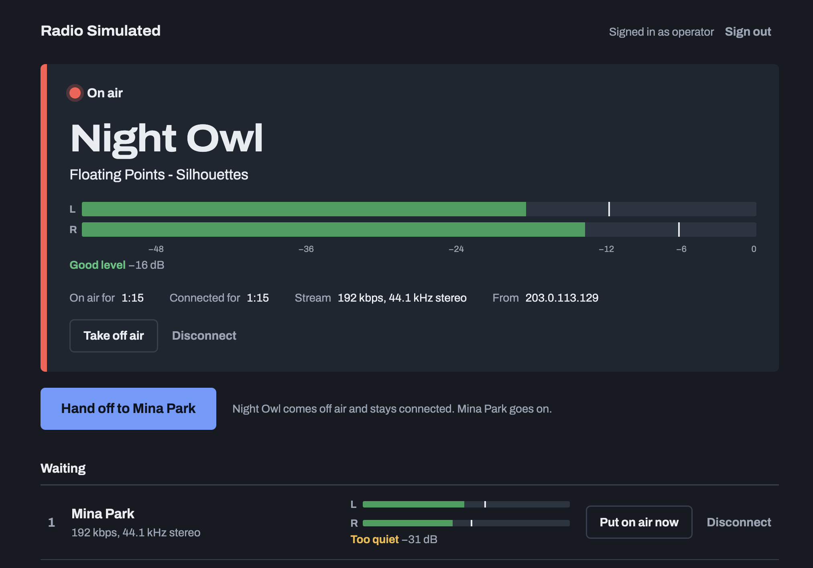

# Icegator

Manages streamer handoffs against a streaming radio station.



## Overview

Icegator simplifies the station operations around show handoffs on a streaming radio station, such as one hosted by [Azuracast](https://www.azuracast.com/).

An Icegator instance is aware of a station's DJs (people who can stream to it) as well as their assigned schedule for streaming to that station.

When a DJ's show time approaches, instead of carefully timing their outgoing stream to start exactly when their show starts, these DJs can stream to Icegator any time. Icegator acts as a schedule-aware multiplexor: It will cut over to the appropriate source only during their scheduled time.

Because of its role as a multiplexor, Icegator has some additional convenience features:

* **HTTP dashboard.** See which streamers are connected and their stream's diagnostics (e.g. bitrate, current metadata)
* **Level check.** Dashboard shows VU-meter style levels of any incoming stream, along with coarse categorization (low, high, good).
* **Auto-recording.** With StreamLover, Icegator can record each show as it airs and upload the recording to StreamLover, attached to the broadcast it belongs to.
* **Configurable policy.** Handoff policy can be configured to either automatically cut off the previous DJ when the current DJ is ready, or to allow this switch to be done manually (though a button in the dashboard) once both are connected.

## Running it

You need Go and [bun](https://bun.sh/).

```
make                                  # builds the dashboard, then bin/icegator
cp icegator.example.yaml icegator.yaml
bin/icegator -hash-password           # type an operator password, paste the hash into the config
bin/icegator -config icegator.yaml
```

DJs point their streaming software at the `listen.ingest` address as an Icecast server, and operators open the `listen.dashboard` address in a browser.

## Configuration

Icegator is configured by one YAML file, given with `-config` (default `icegator.yaml`). [`icegator.example.yaml`](icegator.example.yaml) is a commented starting point. A key Icegator does not recognise is an error, so a typo is caught at startup and not silently ignored.

The `upstream` and `provider` blocks are required. Everything else has a default.

### Environment variables and `.env` files

Anywhere in the file, `${NAME}` is replaced by the environment variable `NAME`. This keeps secrets out of the config. A reference to a variable that is not set is an error. References inside YAML comments are left alone.

The variables can come from the environment Icegator is started in, or from a `.env` file, which is optional. At startup Icegator reads `.env.local` and then `.env` from the same directory as the config file, if they exist. Each holds `NAME=value` lines.

- A variable already set in the environment is never overwritten by a file.
- A variable set in `.env.local` is not overwritten by `.env`, so `.env.local` is the place for one machine's own values.
- `-env-file path` reads that one file instead of the two default ones. It must exist.

```
# .env.local
UPSTREAM_PASSWORD=hunter2
STREAMLOVER_API_KEY=slk_secret_...
```

```yaml
upstream:
  password: ${UPSTREAM_PASSWORD}
```

### `station`

| Option | Default | Meaning |
| --- | --- | --- |
| `name` | empty | The station's name, shown at the top of the dashboard. |

### `listen`

| Option | Default | Meaning |
| --- | --- | --- |
| `ingest` | `:8000` | The address DJs connect their streaming software to. |
| `dashboard` | `:8080` | The address operators open in a browser. |

### `upstream`

Where Icegator sends the audio of whoever is on air. Icegator always streams to the station as this one account, so the station needs no account for each DJ.

| Option | Default | Meaning |
| --- | --- | --- |
| `url` | required | The station's source address, including the mount, such as `http://azuracast.example.com:8005/`. Use `https://` for a TLS source port. |
| `username` | required | The account Icegator streams as. |
| `password` | required | That account's password. |

### `provider`

Where the station's DJs come from. This block is required and holds exactly one provider, named by the key inside it. The provider decides how Icegator runs, so nothing else in the file chooses a mode.

| Provider | DJs and stream keys | Schedule |
| --- | --- | --- |
| `static` | Listed in this file. | None. DJs queue for the air in the order they connect. |
| `streamlover` | From a StreamLover station. | From StreamLover. A DJ goes on air when a show they host is scheduled. |

```yaml
provider:
  streamlover:
    url: https://streamlover.app
    station: example-radio
    api_key: ${STREAMLOVER_API_KEY}
```

Whichever is used, a DJ signs in to Icegator with their username and stream key.

#### `provider.static`

| Option | Meaning |
| --- | --- |
| `djs` | The DJs, as a list. At least one is required. |

Each entry in `djs` has:

| Option | Meaning |
| --- | --- |
| `slug` | The username the DJ signs in with. Must be unique and cannot be `source`. |
| `name` | The name shown on the dashboard and used in titles. |
| `key` | The DJ's stream key, at least 8 characters. `icegator -new-key` prints a new one. Case, hyphens and spaces are ignored when a DJ types it. Must be unique, because software that sends no username is matched on the key alone. |

#### `provider.streamlover`

Follow a StreamLover station. Its DJs sign in with the stream keys StreamLover gives them, and what airs is logged back to StreamLover as broadcasts.

| Option | Default | Meaning |
| --- | --- | --- |
| `url` | required | Where StreamLover is, such as `https://streamlover.app`. |
| `station` | required | The station's id or slug on StreamLover. |
| `api_key` | required | A station API key, made in that station's settings on StreamLover. |
| `sync_interval` | `1m` | How often the DJs, shows and schedule are re-read. |
| `upload_recordings` | `false` | Record what each DJ sends to air and upload it to StreamLover as that broadcast's recording. Each turn on air with a show becomes one MP3, made of exactly the audio that was sent to the station. It is written to disk under `state_dir`, uploaded when the turn ends, and deleted once StreamLover has it. A file over 500 MB, which is StreamLover's limit, is kept on disk under `recordings/undelivered`. |
| `visibility` | `private` | Whether the broadcasts Icegator logs start out `private` or `public`. Private keeps a show and its recording from listeners until someone publishes the episode. |

### `handoff`

How the air passes from one DJ to the next.

| Option | Default | Meaning |
| --- | --- | --- |
| `policy` | `manual`, or `auto` with a schedule | What happens when a DJ with a claim to the air is ready while another DJ is on it. Without a schedule that is any DJ who connects, and with one it is the DJ whose show is now on. `auto` puts them on air as soon as their audio is flowing. `manual` waits for an operator to hand off, or, without a schedule, for the DJ on air to disconnect. |
| `overrun` | `none` | Only for a provider with a schedule, and an error otherwise. How long a DJ may stay on air past the end of their show when the next show's DJ is not ready, or nothing is scheduled next. `none` sets no limit. `strict` takes the DJ off as their show ends. A duration such as `60s` or `10m` allows that much. A scheduled DJ who is ready takes over whatever this says. |
| `station_connection` | `reopen` | What happens to the connection to the station at a handoff. `reopen` closes it and opens a new one for the next DJ, so the station plays its own programming for a moment in between. `keep` hands the same connection to the next DJ, so the station hears one continuous source. Nothing is re-encoded either way. |
| `ready_after` | `3s` | How much audio a DJ must send before they can go on air. |

### `metadata`

| Option | Default | Meaning |
| --- | --- | --- |
| `fallback` | `{dj}`, or `{show} with {dj}` with a schedule | The title sent to the station when the DJ's software has sent none. `{dj}` is replaced by the DJ's name and `{show}` by the show's. |

Titles the DJ's software does send are passed on as they are.

### `operators`

Who may sign in to the dashboard. A list. With nobody listed, the dashboard is not served at all.

| Option | Meaning |
| --- | --- |
| `username` | The name the operator signs in with. |
| `password_hash` | A bcrypt hash of their password. `icegator -hash-password` reads a password and prints its hash. |

### `levels`

The loudness, in dBFS averaged over a few seconds, behind the dashboard's verdict on each DJ's stream. Values are negative.

| Option | Default | Meaning |
| --- | --- | --- |
| `silent_dbfs` | `-60` | Below this the stream counts as silent. |
| `low_dbfs` | `-24` | Below this it is too quiet. |
| `high_dbfs` | `-5` | Above this it is too hot. |

### `state_dir`

One value, not a block. The directory for what has to survive a restart, which with the `streamlover` provider is recordings waiting to be uploaded and the last copy of the station's DJs and schedule. Default `state`, relative to where Icegator is started.

## Developing

```
make test                             # go vet, go test, typecheck, lint
make dev-station                      # a fake station on 127.0.0.1:8005, so nothing goes on air
bin/icesource -addr 127.0.0.1:8000 -user alice -pass AAAA-2222 -file some.mp3
cd web && bun start                   # dashboard with hot reload, proxying to a running icegator
cd web && bun run sim                 # dashboard alone, against a simulated station
```

`bun run sim` needs no Icegator and no streams. The dashboard runs against a station simulated in the browser, and a toolbar at the bottom of the page connects and drops DJs, sets their levels, and switches between states that are awkward to produce for real, such as a lost station connection or a show overrunning. The simulator is not part of the built dashboard.

`icesource` is a small source client that streams an MP3 in real time and can send title updates, standing in for DJ software.
